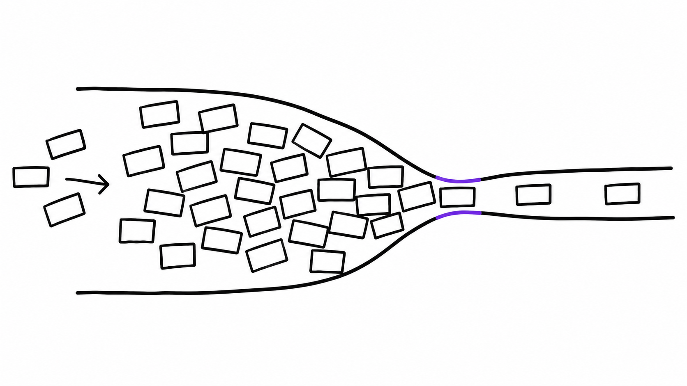
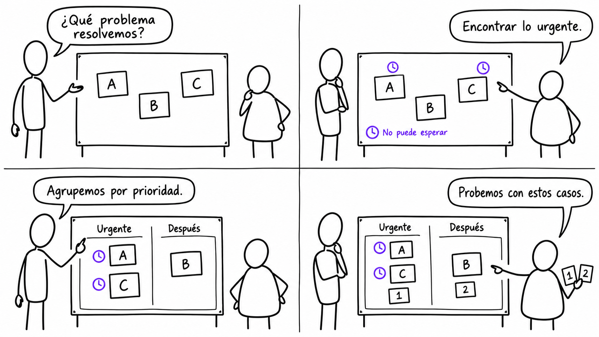
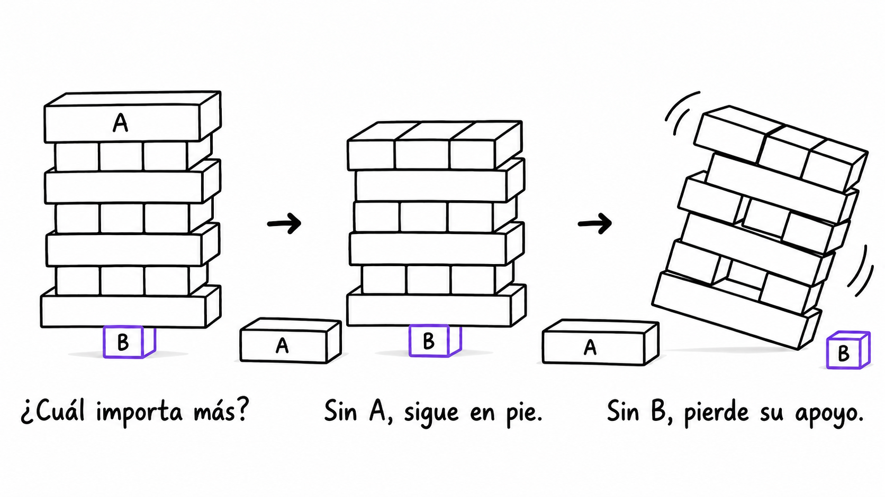

# Ilustraciones Shape Up

[English](README.md)

Haz comprensible una idea mediante una ilustración original dibujada a mano:
trazos simples y decididos, espacio en blanco y color cuando algo merece énfasis.
Explica una afirmación, desarrolla un concepto abstracto o muestra a personas
trabajando sobre una idea.

## Casos de uso

Estos ejemplos originales generados muestran tres composiciones. Reutiliza el
mecanismo explicativo para tu tema; la skill elige una representación según la
idea. La generación varía entre ejecuciones. Ejecuta los prompts desde la raíz de
este repositorio; en otro proyecto, cambia las rutas y usa su DESIGN.md.

### 1. Una idea, una imagen

**Poner más trabajo en marcha no elimina un cuello de botella.** Las fichas se
acumulan en un canal ancho antes de un paso estrecho. El violeta enfatiza la
restricción; la salida de una en una muestra por qué añadir más fichas solo
hace crecer la cola.



```text
Usa $shapeup-illustrations para explicar que poner más trabajo en marcha no
elimina un cuello de botella. Genera una sola imagen estática con una relación
visual clara, sin viñetas ni secuencia temporal. Elige la representación;
texto en español solo si hace falta. Usa examples/DESIGN.md.
Guarda en examples/simple-idea/.
```

[Prompt exacto de generación](examples/simple-idea/generation-prompt.txt) ·
[Detalles de generación](examples/simple-idea/example.md).

### 2. Personas que desarrollan una idea

**Acordar el criterio de urgencia permite organizar una propuesta compartida.**
Dos compañeros desarrollan la misma pizarra en cuatro viñetas: tarjetas sueltas,
un criterio explícito de urgencia, grupos por prioridad y una prueba con casos.
Las marcas de reloj violetas conservan el criterio mientras cambia la pizarra.



```text
Usa $shapeup-illustrations para cuatro viñetas en una cuadrícula de 2x2 con dos
compañeros trabajando sobre el mismo artefacto. Explica que acordar el criterio
de urgencia permite organizar su propuesta. El dibujo compartido debe cambiar
visiblemente. Incluye estas líneas exactas en globos, en orden de lectura:
"¿Qué problema resolvemos?"
"Encontrar lo urgente."
"Agrupemos por prioridad."
"Probemos con estos casos."
Usa examples/DESIGN.md. Guarda en examples/character-narrative/.
```

[Prompt exacto de generación](examples/character-narrative/generation-prompt.txt) ·
[Diálogo, composición e inspección](examples/character-narrative/example.md).

### 3. Un concepto abstracto que evoluciona

**La importancia de una pieza depende de lo que sostiene, no de su tamaño.**
La misma torre inspirada en Jenga sigue en pie al retirar la pieza grande A de
la cima y se inclina al retirar su pequeño apoyo B. El violeta identifica a B
en todos los estados. El objeto cambiante lleva el argumento y unas notas breves
guían la lectura.



```text
Usa $shapeup-illustrations para explicar que la importancia de una pieza depende
de lo que sostiene, no de su tamaño. Muestra una progresión abstracta de la misma
torre de bloques inspirada en Jenga. Conserva el objeto y sus identidades;
el acento debe enfatizar solo lo que ayude a comprender el cambio. Sin personas.
Elige los estados y el texto necesario en español. Usa examples/DESIGN.md.
Guarda en examples/conceptual-progression/.
```

[Prompt exacto de generación](examples/conceptual-progression/generation-prompt.txt) ·
[Estados, corrección dirigida y limitaciones observadas](examples/conceptual-progression/example.md).

## Configuración y compatibilidad

Invoca `$shapeup-illustrations` o pide la skill por su nombre. Describe la idea,
la audiencia, el texto exacto si hace falta y el destino. Por defecto, guarda
los resultados locales en `assets/<topic-slug>-shapeup/` dentro de tu proyecto,
con un registro de generación en Markdown.

Usa un agente con generación de imágenes GPT nativa o Codex CLI instalado y
autenticado con esa capacidad. Una opción autenticada no necesita una clave API
nueva. Sin una ruta disponible, el agente puede preparar el prompt, pero no generar
la imagen. Los resultados son dibujos; se excluyen capturas y composiciones basadas
en capturas.

### Colores y DESIGN.md

Para cada elección por separado: **petición explícita → DESIGN.md aplicable al
proyecto → valores por defecto de la skill**. Si los valores del proyecto entran
en conflicto, prevalece el documento más cercano en la ruta de salida. Por defecto,
el fondo es blanco y la tinta casi negra. El acento es opcional y tiene una función
explicativa; el violeta de los ejemplos no es un tema global.

```text
Usa el DESIGN.md de este proyecto para la paleta.
```

```text
Respeta DESIGN.md, pero usa azul #2563EB para enfatizar el alcance revisado.
```

Cambiar el acento conserva las otras decisiones de paleta. DESIGN.md guía colores
y fondo mientras el dibujo mantiene su lenguaje visual. GPT puede aproximar los
hexadecimales pedidos. [examples/DESIGN.md](examples/DESIGN.md) solo aplica a esta
galería. Consulta las [reglas de estilo y color](references/style.md).

## Referencias y derechos

Los dibujos originales de Basecamp en `assets/references/` calibran el estilo;
sus autores conservan sus derechos. Las [fuentes y procedencia](references/sources.md)
explican qué referencias seleccionar. Los ejemplos generados aprobados están en
`examples/`. Las iteraciones y pruebas de desarrollo están separadas y no se cargan
por defecto al generar. Consulta las [notas de desarrollo](development/README.md)
al mantener la skill.

## Mantenimiento del repositorio

Si tienes acceso al repositorio privado, clónalo y haz los commits y pushes dentro de la copia:

```bash
git clone https://github.com/jerolan/shapeup-illustrations.git
cd shapeup-illustrations
```

En dotfiles, la copia está en `agents/skills/shapeup-illustrations`. Haz los commits y pushes de la skill desde ese directorio:

```bash
git -C agents/skills/shapeup-illustrations status
git -C agents/skills/shapeup-illustrations add README.md README.es.md
git -C agents/skills/shapeup-illustrations commit -m "Update illustration documentation"
git -C agents/skills/shapeup-illustrations push origin main
```

Prepara solo los archivos que cambiaste. Después de un commit de la skill, prepara la ruta del submódulo en dotfiles para registrar el nuevo commit. Confirma ese puntero por separado cuando corresponda. Una máquina nueva necesita acceso a GitHub para inicializar este submódulo privado.
