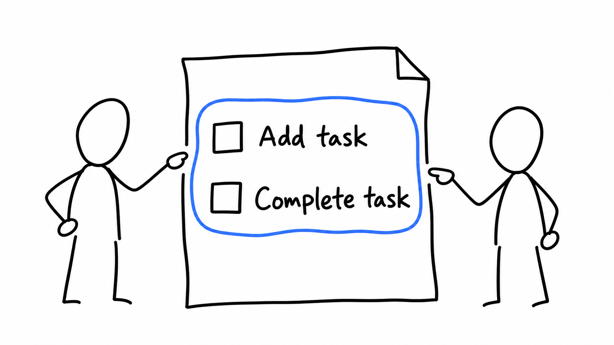

# Ilustraciones Shape Up

[English](README.md)

Crea ilustraciones originales a mano para explicar ideas, cambios en propuestas y conversaciones de equipo con el lenguaje visual de Shape Up. La skill dibuja escenas y diagramas, no capturas ni composiciones basadas en capturas.

## Requisitos

Usa un agente con generación de imágenes GPT nativa o Codex CLI instalado y autenticado con generación de imágenes GPT disponible. No necesitas una clave API nueva si cuentas con una opción autenticada. Si ninguna está disponible, el agente puede entregar un prompt, pero no generar la imagen.

## Uso

Invoca `$shapeup-illustrations` en tu agente o pide la skill por su nombre, `shapeup-illustrations`. Describe la idea, la audiencia, el texto exacto que debe aparecer y el destino deseado. El agente elige una composición, genera la imagen y la inspecciona. Por defecto, guarda las imágenes locales en `assets/<topic-slug>-shapeup/` dentro de tu proyecto, junto con un archivo Markdown complementario.

Usa una escena para una idea o una secuencia cuando importe mostrar el cambio. Las conversaciones de cuatro viñetas usan una cuadrícula de 2×2, pero también hay otras composiciones y cantidades de viñetas. El diálogo va dentro de cada viñeta; también puede incluir una breve nota explicativa cuando haga falta.

## Ejemplos

Estos ejemplos son ilustraciones originales generadas, no copias del libro. Las cadenas en inglés son el texto solicitado para las imágenes. La generación puede variar entre ejecuciones y no garantiza imágenes idénticas.

Ejecuta estos prompts desde la raíz de este repositorio. En otro proyecto, cambia las rutas de salida y usa el `DESIGN.md` de ese proyecto.

### Una primera versión pequeña



El límite selecciona solo dos acciones para la primera versión. El azul solicitado reemplaza el acento violeta del diseño de ejemplo sin cambiar la tinta ni el fondo.

Pide lo siguiente:

```text
Usa $shapeup-illustrations para mostrar una primera versión pequeña de una app de tareas.
Dibuja dos personas señalando una lista de papel con solo "Add task" y
"Complete task". Usa el acento azul #2563EB para el límite de ese alcance.
Respeta examples/DESIGN.md para los demás colores. Haz una imagen horizontal,
sin título ni diálogo. Guárdala en examples/01-small-first-version.png.
```

El [archivo complementario](examples/01-small-first-version.md) contiene el prompt detallado de generación y la paleta.

### Una idea evoluciona en una conversación


Lee de izquierda a derecha y después hacia abajo:

1. Proponer una app de tareas con lista y recordatorios.
2. Cuestionar si los recordatorios pertenecen a la primera versión.
3. Tachar la campana y seleccionar solo la lista.
4. Probar la propuesta reducida marcando una casilla en el prototipo de papel.

El diálogo explica cada cambio dentro de su viñeta. La pizarra compartida hace visible la revisión, en lugar de depender solo de los mensajes.

Pide lo siguiente:

```text
Usa $shapeup-illustrations para mostrar a dos compañeros desarrollando una idea de app de tareas.
Haz una imagen de cuatro viñetas en una cuadrícula de 2x2. Mantén las mismas personas y pizarra.
Muestra la idea, una objeción sobre recordatorios, un alcance menor y una prueba en papel.
Pon este diálogo en globos dentro de las viñetas, en orden de lectura:
"Let's build a task app."
"Do we need reminders now?"
"Start with add and complete."
"Let's try this first."
Usa examples/DESIGN.md para la paleta. Guarda examples/02-idea-conversation.png.
```

El [archivo complementario](examples/02-idea-conversation.md) contiene el prompt detallado de generación y una tabla de estados, diálogo y continuidad.

## Color y diseño del proyecto

Para cada color, una petición explícita tiene prioridad sobre el `DESIGN.md` aplicable y después sobre los valores por defecto de la skill. Cambiar el acento no cambia el fondo. El documento de diseño aplicable guía la paleta y el fondo, pero no convierte el dibujo en una maqueta de interfaz.

Sin indicaciones del proyecto ni una petición explícita, la skill usa negro sobre blanco con acentos funcionales discretos.

[examples/DESIGN.md](examples/DESIGN.md) solo aplica a estos ejemplos. No es un tema global para los proyectos que usan la skill. GPT puede aproximar un color hexadecimal sin reproducirlo exactamente. Consulta las [reglas de color y diseño](references/style-dna.md#custom-accents-and-designmd) para conocer cómo el agente selecciona las instrucciones del proyecto.

## Referencias y derechos

Los dibujos de Basecamp en `assets/examples/` son referencias de calibración. Sus autores conservan sus derechos. Consulta las [fuentes y su procedencia](references/sources.md). La skill crea escenas nuevas en lugar de copiar esas obras.

## Mantenimiento del repositorio

Si tienes acceso al repositorio privado, clónalo y haz los commits y pushes dentro de la copia:

```bash
git clone https://github.com/jerolan/shapeup-illustrations.git
cd shapeup-illustrations
```

En dotfiles, la copia está en `agents/skills/shapeup-illustrations`. Haz los commits y pushes de la skill desde ese directorio:

```bash
git -C agents/skills/shapeup-illustrations status
git -C agents/skills/shapeup-illustrations add README.md README.es.md
git -C agents/skills/shapeup-illustrations commit -m "Update illustration documentation"
git -C agents/skills/shapeup-illustrations push origin main
```

Prepara solo los archivos que cambiaste. Después de un commit de la skill, prepara la ruta del submódulo en dotfiles para registrar el nuevo commit. Confirma ese puntero por separado cuando corresponda. Una máquina nueva necesita acceso a GitHub para inicializar este submódulo privado.
