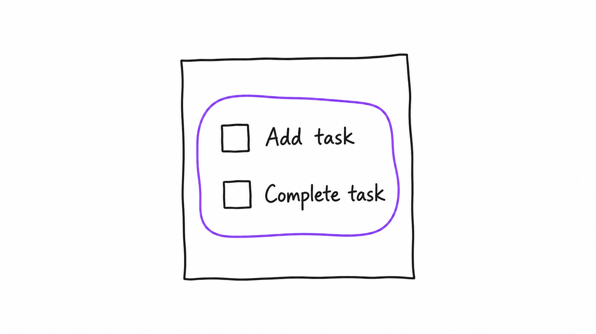
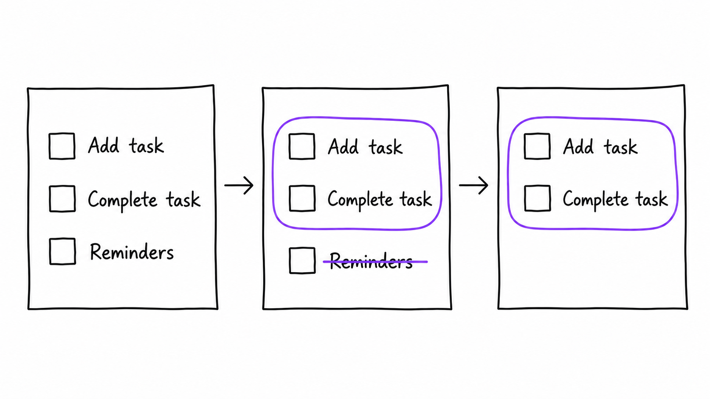
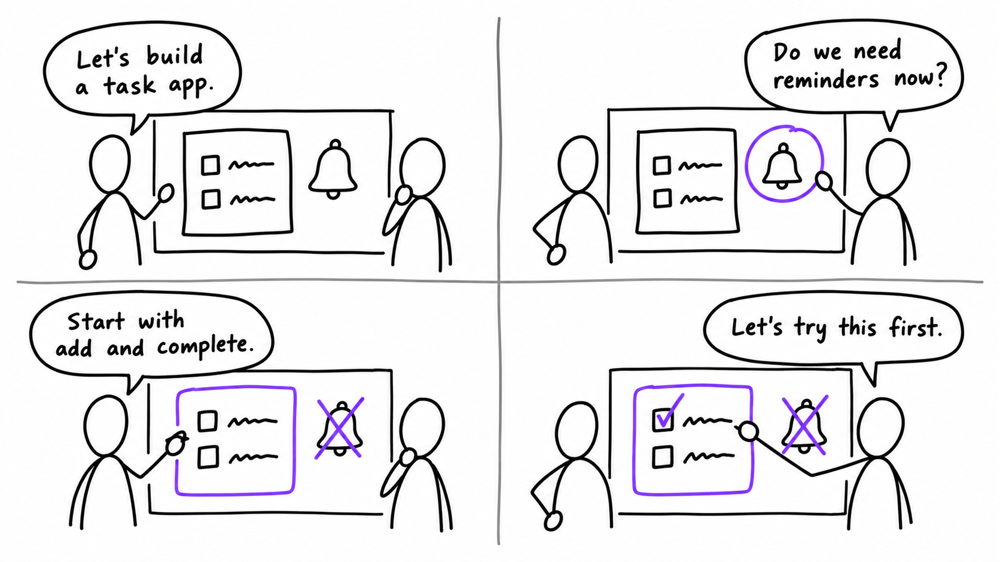

# Shape Up illustrations

[Español](README.es.md)

Create original illustrations in the visual language of Shape Up: simple hand-drawn lines, generous whitespace, and color that directs attention. Explain one idea, show how it changes, or tell how a team develops it.

## Use cases

These three examples explore the same task app with increasing visual complexity. They are original generated illustrations. The prompts request the English text shown in the images; generation can vary between runs.

Run the prompts from this repository's root. In another project, change the output paths and use that project's `DESIGN.md`.

### 1. One simple idea

A single image makes a scope decision visible: the first version includes adding and completing tasks. The violet boundary encloses just those two actions. No characters or dialogue are needed.



```text
Use $shapeup-illustrations to show the initial scope of a task app.
Draw one paper list with only "Add task" and "Complete task", both with empty
checkboxes, inside a violet scope boundary. No people, headline, or dialogue.
Use examples/DESIGN.md for the palette. Make one landscape image.
Save it as examples/01-single-idea.png.
```

[Generation details and palette](examples/01-single-idea.md).

### 2. A concept evolves

The same list develops from left to right: propose three actions, cross out reminders while selecting the other two, then keep only the initial scope. The paper and unchanged entries stay recognizable so the reader can follow the revision.



```text
Use $shapeup-illustrations to show a task app proposal evolving in three steps.
Make one landscape image with three paper lists, read left to right:
1. Empty checkboxes labeled "Add task", "Complete task", and "Reminders".
2. The same list, with "Reminders" crossed out and a violet boundary enclosing
   only "Add task" and "Complete task".
3. The same paper and boundary with only "Add task" and "Complete task" remaining.
Keep the paper, row positions, and lettering consistent. No people or dialogue.
Use examples/DESIGN.md for the palette. Save examples/02-list-progression.png.
```

[Generation details and state table](examples/02-list-progression.md).

### 3. A conversation develops the idea

Characters, gestures, and dialogue add the reasons behind the changes. Read left to right, then down: propose the app, question reminders, narrow the scope, and try the paper prototype. The shared whiteboard changes with the conversation.



```text
Use $shapeup-illustrations to show two teammates developing a task app idea.
Make one image with four panels in a 2x2 grid. Keep the same people and whiteboard.
Show the idea, an objection about reminders, a narrower scope, and a paper trial.
Put this dialogue inside speech bubbles, in reading order:
"Let's build a task app."
"Do we need reminders now?"
"Start with add and complete."
"Let's try this first."
Use examples/DESIGN.md for the palette. Save examples/02-idea-conversation.png.
```

[Generation details, dialogue, and continuity](examples/02-idea-conversation.md).

## Setup and compatibility

### Invoke the skill

Invoke `$shapeup-illustrations` in your agent, or ask for the skill by name. Describe the idea, the audience, any exact visible text, and the output destination. The agent selects a composition, generates the image, and inspects it. By default, local images go in `assets/<topic-slug>-shapeup/` in your project, with a Markdown sidecar.

One scene can explain one idea; sequences show meaningful changes. Four-panel conversations use a 2×2 grid, but other layouts and panel counts are available. The skill creates drawn scenes and diagrams, excluding screenshots and screenshot-based compositions.

### Image generation

Use an agent with native GPT image generation, or an installed, authenticated Codex CLI with GPT image generation available. You do not need a new API key for an authenticated route. If neither route is available, the agent can provide a prompt but cannot generate the image.

### Colors and DESIGN.md

For each color choice, the priority is **explicit request → applicable project `DESIGN.md` → skill defaults**. The agent checks the project root and the output directory's path; the nearest scoped design document wins when values conflict.

For example:

```text
Use this project's DESIGN.md for the palette.
```

To override just the accent:

```text
Respect DESIGN.md, but use blue #2563EB for the scope boundary.
```

An accent override changes the accent while preserving the other palette choices. The design document guides colors and background while the illustration keeps its hand-drawn style. Without project guidance or an explicit request, the skill uses black on white with restrained functional accents.

[examples/DESIGN.md](examples/DESIGN.md) applies only to these examples, not to projects that install the skill. GPT may approximate a requested hex color rather than match it exactly. See the [color and design rules](references/style-dna.md#custom-accents-and-designmd).

## References and rights

The Basecamp drawings in `assets/examples/` are calibration references. Their authors retain their rights. See [sources and provenance](references/sources.md). The skill creates new scenes rather than copying reference artwork.

## Maintain the repository

With access to the private repository, clone it and make commits and pushes inside the checkout:

```bash
git clone https://github.com/jerolan/shapeup-illustrations.git
cd shapeup-illustrations
```

In dotfiles, the checkout lives at `agents/skills/shapeup-illustrations`. Commit and push the skill from that directory:

```bash
git -C agents/skills/shapeup-illustrations status
git -C agents/skills/shapeup-illustrations add README.md README.es.md
git -C agents/skills/shapeup-illustrations commit -m "Update illustration documentation"
git -C agents/skills/shapeup-illustrations push origin main
```

Stage only the files you changed. After a skill commit, stage the submodule path in dotfiles to record its new commit. Commit that pointer separately when ready. A new machine needs GitHub access to initialize this private submodule.
